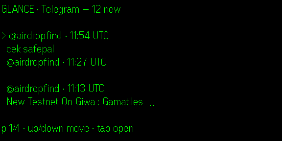
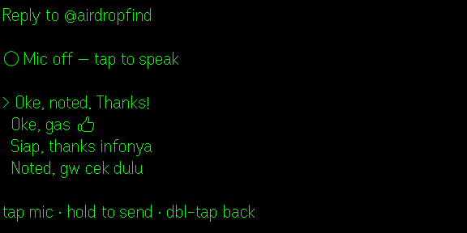
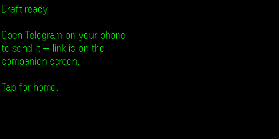

# Glance — Telegram digest + voice reply for Even Realities G2

**Heads Up: Even Realities Hackathon** · Track 01 Messaging & News · aiming for Best Telegram Integration

One glance, one action: unread Telegram channel posts condensed for the G2's
576×288 monochrome display, reply by voice or quick chip, tap to send via
Telegram on your phone.

## The problem

Telegram is where a lot of people live — but every check means pulling out
the phone, unlocking it, opening the app, scrolling. On smart glasses the
screen is tiny, there is no keyboard, and attention is the scarcest resource.
Glance answers one question per screen: *what's new, and what do I do about
it?*

## How it works

- **Read** — the backend fetches recent posts from public Telegram channels
  (`t.me/s/<channel>` pages, no login, no bot token) and condenses them into
  short headlines. Default channels: `airdropfind`, `telegram`, `durov`
  (changeable in the companion UI, remembered on-device).
- **Write** — template-based draft replies (bilingual Indonesian/English,
  keyword-aware, no LLM, no API key) plus quick-reply chips. Pick one, tap
  send, and the companion UI shows a Telegram deep link (`t.me/share/url`)
  with the draft prefilled — you choose the chat on your phone.
- **Voice** — the G2 microphone streams PCM 16 kHz s16le mono through the
  Even Hub SDK to the backend `/api/stt`, which transcribes locally with
  faster-whisper (tiny model, CPU). No cloud, no key, no audio stored. If
  the STT engine is not installed on the server, the API answers a clean
  501 and the app falls back to chips + typed input.

No accounts, no wallet, no KYC, no user data stored anywhere. The digest is
public-channel data only. Nothing in this repo holds user funds or touches
money — there is no money feature at all.

## Screens (576×288, real simulator captures)

| Home | Item |
|---|---|
|  |  |
| 12 new posts, top headlines, up/down to move, tap to open. | Full message, paginated, tap to reply. |

| Reply | Sent |
|---|---|
|  |  |
| Mic state, draft + quick chips, tap mic to speak. | Draft ready — open Telegram on your phone to send. |

## Quick start

### 1. Backend (Node 20+)

```bash
cd server
node index.mjs            # http://localhost:3101
```

Optional speech-to-text (local, CPU):

```bash
python3 -m venv ~/.venvs/glance-stt
~/.venvs/glance-stt/bin/pip install faster-whisper
# the tiny model downloads on first use (~75 MB)
```

Without it, `/api/stt` answers 501 and the app still works (chips + typed
input). The server needs no keys and stores nothing.

Production: the same handlers are in `api/` as Vercel serverless functions
(`vercel deploy`, then put the deployed origin in `glance-app/app.json`
under the `network` permission whitelist — it currently allows
`http://localhost:3101` for local development only).

### 2. Glasses app (Vite + TypeScript)

```bash
cd glance-app
npm install
npm run dev               # http://localhost:5173
npm run build             # production bundle in dist/
npm run pack              # build + evenhub pack -> glance.ehpk
```

### 3. Run in the simulator (no glasses needed)

```bash
# needs libwebkit2gtk-4.1 + xvfb on Linux
xvfb-run -a evenhub-simulator http://localhost:5173
```

Headless test harness (proves boot + navigation + zero console errors):

```bash
python3 scripts/sim-test.py click down click long_press
```

## Architecture

```
glance-app/            Vite + TS Even Hub app
  src/main.ts          bridge, screens (home/item/reply/sent), event routing
  src/ui.ts            companion web UI (phone side: channels, voice stand-in,
                       glasses-state mirror, Telegram send link)
  src/asr/stt.ts       STT client: mic PCM -> POST /api/stt
  src/api.ts           digest / draft / share client (single backend origin)
  app.json             package_id com.ipan8.glance, v0.1.0,
                       permissions: network + g2-microphone,
                       supported_languages: ["en"] (the SDK accepts only
                       en/de/fr/es/it/zh/ja/ko — "id" is rejected by pack
                       validation; draft content is still bilingual ID/EN)
server/                shared backend (Node, no framework)
  digest.mjs           fetch + parse t.me/s pages, condense, 60 s cache
  draft.mjs            template-based draft replies (ID/EN)
  stt.mjs              faster-whisper wrapper (optional, 501 if absent)
  index.mjs            local dev server on :3101
api/                   Vercel serverless wrappers (digest, draft, share, stt)
scripts/sim-test.py    headless simulator harness (screenshots + input + checks)
docs/                  SPEC.md, SDK-REFERENCE.md, screenshots
```

## What existed before 23 Nov 2026

Per the hackathon rules: the app is built on the **`asr` template** from
[even-realities/evenhub-templates](https://github.com/even-realities/evenhub-templates)
(mic capture + STT client skeleton + companion UI shell) and the public
**Even Hub SDK** (`@evenrealities/even_hub_sdk` 0.0.16). Everything else —
the digest backend, the draft engine, all four screens, the navigation and
pagination logic, the simulator test harness, and this README — was written
during the hackathon (25–29 Nov 2026).

## Honest notes

- The demo video is recorded in the **simulator**, not on physical G2
  glasses. In the simulator there is no mic device, so the voice part of
  the demo uses a typed transcript stand-in in the companion UI — labelled
  on screen as simulator-only. The mic capture path itself is real code
  (from the `asr` template) and the STT backend is proven end-to-end on
  real speech (faster-whisper tiny).
- The digest reads **public channels only**. Private chats and groups need a
  Telegram login the app deliberately does not ask for — see feature
  request #1.
- The demo backend runs on localhost. For a real deployment, deploy `api/`
  to Vercel and update the whitelist in `app.json`.

## Feature requests for the Even Realities platform

1. **Consented Telegram read scope for glasses apps** — a user-approved way
   to read private chats/groups (not just public channels), so a digest app
   can cover the messages people actually need to answer.
2. **Bundled or on-device STT** — ship a small speech model with the SDK or
   the phone app so voice reply works without every developer self-hosting
   a transcription backend.
3. **Simulator mic input** — let the simulator accept a WAV file as mic
   input, so voice flows can be tested headlessly end-to-end.
4. **Inline image/thumbnail primitives** for the 576×288 display, so link
   previews and photos can be glanced at instead of described in text.
5. **Deep-link handoff with a result** — let the glasses app hand a payload
   to the phone app and receive a confirmation back (e.g. "message sent"),
   instead of only opening a URL one-way.

## License

MIT — see [LICENSE](LICENSE).
